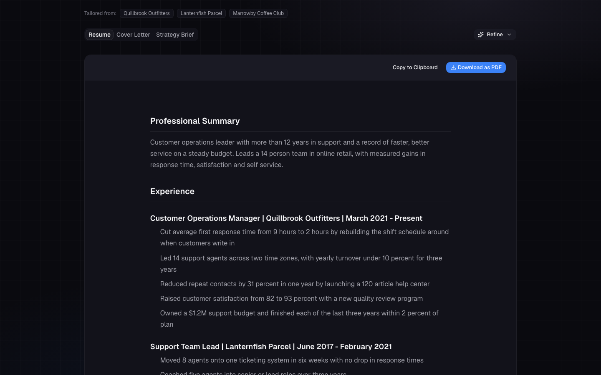
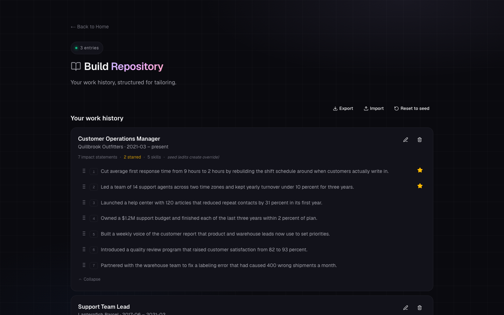
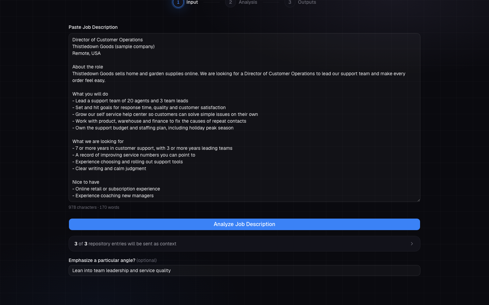
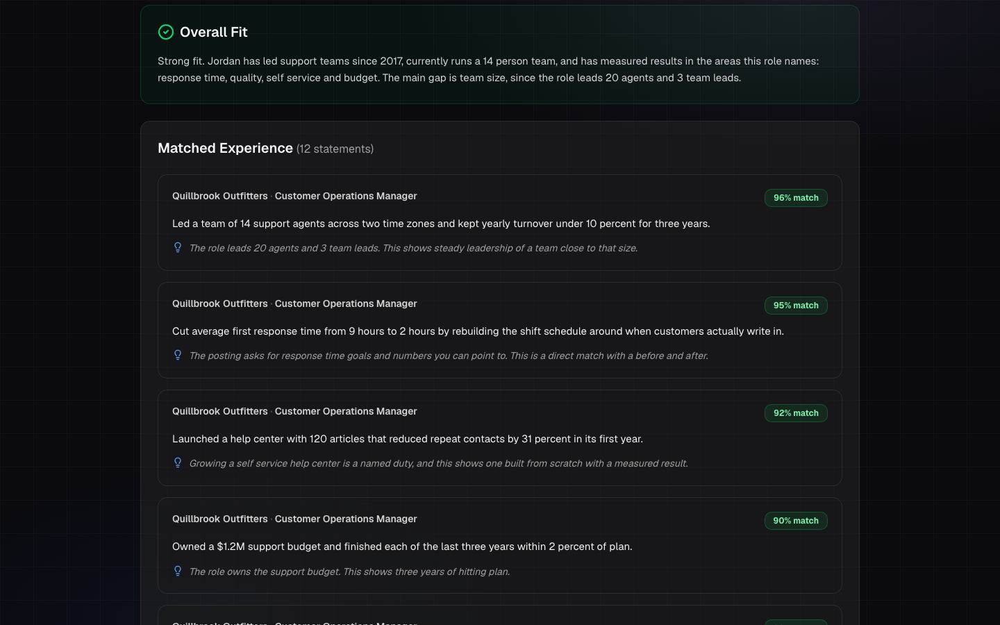

# Resume Builder

**Turns your experience into a tailored resume for each job.**

Built for my own job search · Code is private, this repo is the walkthrough

*The person, employers and job posting in these screenshots are invented. The screens are the real app. The AI results shown are sample text made for this demo, not live output.*

## The problem

One resume does not fit every job. Tailoring it by hand means digging through years of work, picking the lines that fit the posting and rewriting them each time.

Asking a chatbot to do it is faster, but it can add skills you don't have and numbers you never hit.

## Who it's for

I built this for my own job search. There is one user, and it's me. I needed to answer:

- **Which parts of my experience matter for this job?**
- **How do I say them so the person hiring gets it in under a minute?**
- **Is every line still true?**

## What it does

| Screen | What it does |
|---|---|
| **Experience bank** | Every role I've held, with a list of results under each one. Add a role by voice, by pasting text or by typing. Drag results into order and star the ones that matter most. |
| **Job description** | Paste a posting, choose which roles to draw from, and add a note on what to emphasize. Drafts save as you type. |
| **Match review** | Shows what the AI read in the posting, an overall fit summary, and each picked result with a score and a reason. Nothing is written until I press Generate. |
| **Tailored output** | A resume, a cover letter and an interview prep brief. Refine any of them with a preset or my own instruction. Earlier versions are kept. |
| **Export** | Copy any output as text. Download the resume and cover letter as PDFs. Back up the experience bank as a file. |
| **Tracker** | Applications, contacts, appointments and activity, with flags for applications that have gone quiet. |
| **Companies and strategy** | A ranked list of target companies, and a playbook of recruiters and job boards with outreach status and notes. |

## How it works

- **Experience is stored as small pieces.** Each role holds short result statements with tags, a rank and an optional star. A base file holds the history, and my edits save in the browser on top of it.
- **The posting becomes a checklist.** The AI pulls out the title, level, required skills, nice to haves, themes and culture signals.
- **Picking comes before writing.** One step matches my results to that checklist, with a score and a reason for each. It is told to favor my ranking and to include a starred result when it fits.
- **Then it rewrites.** A separate step writes the resume for a busy executive: outcome first, plain words, no internal project names. It is told to keep every number.
- **Guardrails against making things up.** The resume step sees only the matched results and my profile details, and is told not to add facts. When I paste in a role, the AI is told to leave unclear details blank instead of guessing. Roles added by voice or paste come up for review before they save.
- **The resume PDF is stricter than the screen.** Its bullets come from the matched results, not the rewrite. Company names, dates, contact details and education come straight from the stored profile. Only the summary is newly written.
- **Keys stay on the server.** The browser never calls the AI service directly.

The limits: most of these guardrails are instructions to the model. No code compares each finished line with its source, so a person still has to read it before it goes out.

## Stack

TypeScript, Next.js 16, React 19, Tailwind CSS 4, Claude API, Deepgram (voice to text), React PDF, dnd kit, Radix UI, Vitest. Data lives in a JSON file and browser storage, with no database. Built with Claude Code.

## What I learned

- **Being your own first user cuts the guessing.** I know when a line misses the point, because I'm the one who has to send it. Ranking, stars and the plain language rules exist for that reason.
- **One user is also a blind spot.** My own history and target list are baked into the app. It works for me, but that doesn't prove it works for you.
- **AI helped most with reading and sorting.** It turns a long posting into a checklist, searches a big pile of results, and gets a first draft on the page.
- **I had to keep control of the facts.** What's true, what counts as my best work and what gets sent are my calls. The app makes the AI show its picks and reasons first.

## Status

A personal tool with one user, no login and no public demo. Voice input needs its own transcription key. Next on the list: reading a posting from a link, and more resume layouts.

---

Built by [John Ross](https://github.com/JR-BEI) · [X @TheFinalRoss](https://x.com/TheFinalRoss) · [LinkedIn](https://www.linkedin.com/in/johnrossbuilds)
